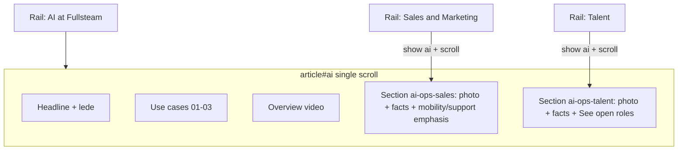

# Extend AI panel with operational content (below video)

## Context

You chose to place the screenshot content **inside `#ai`**, not as separate hi-fi panels. That content is wireframe copy for **Sales & Marketing** (Reach/Scale/Proof/Constraint, team photo) and **Talent** (Mobility/Support themes, culture facts, **See open roles**) from [`02_Wireframes/active/pages/our-advantage.html`](02_Wireframes/active/pages/our-advantage.html) and [`content-slots.md`](content-slots.md) §6 — not additional use-case cards.

**Current state:** [`03_Design/client-review/homepage/our-advantage.html`](03_Design/client-review/homepage/our-advantage.html) `#ai` already has headline, lede, Use cases grid, and Overview video. Separate `#sales-marketing` / `#talent` articles exist as `panel--placeholder` stubs with overlapping copy.

**IA note:** This is a **client-review presentation change** (one long “AI at Fullsteam” story). Wireframe + content-slots still describe three Operational Excellence panels; document the exception in `design-notes.md` and flag for client re-lock (OI-14) if this becomes permanent.

---

## 1. Markup — append two sections after the video block

In `#ai` (after `.ai-video`), add two **`panel__block`** sections with stable IDs:

| Section ID | Content (from wireframe / your screenshot) |
|------------|-----------------------------------------------|
| `ai-ops-sales` | Optional kicker (e.g. “Reach” or “Sales & marketing”); [`frame--pending`](03_Design/client-review/homepage/our-advantage.html) photo; **2×2 `.facts.facts--4`**: Reach, Scale (OI-5 gated wording), Proof, Constraint; optional short **Mobility** / **Support** callouts as two-column `.use-grid` or compact cards using wireframe body copy (no “Intent:” in hi-fi). |
| `ai-ops-talent` | Kicker “Talent”; photo placeholder; **2×2 facts**: Scale (2,000+ gated), Culture, Proof, Constraint; **`.btn`** → Workday (same URL as existing Talent stub). |

Reuse existing ledger primitives already in the file: `.kicker`, `.facts`, `.facts--4`, `.frame--pending`, `.use-grid`, `.btn` — same patterns as [`#sales-marketing`](03_Design/client-review/homepage/our-advantage.html) lines ~1056–1078 and [`#talent`](03_Design/client-review/homepage/our-advantage.html) lines ~1082–1098.

**Copy rules:** Keep publishability gates (OI-5) on Scale lines; no cleared KPIs; no `.anno` boxes in hi-fi.

**Headings:** Apply `.panel--ai .panel__title { max-width: none; }` pattern to any new section titles if used; subsection kickers use existing `.kicker` mono style.

---

## 2. Retire duplicate stub panels

Remove or empty standalone articles `#sales-marketing` and `#talent` so content is not duplicated when those rail items are clicked.

- Delete inner content from those `<article>` nodes **or** remove the articles entirely and teach JS to treat those slugs as aliases (preferred: **remove articles**, keep slugs only on rail links).

---

## 3. Panel JS — alias slugs to `#ai` + in-panel scroll

In the offerings IIFE (~1290–1354):

- Map **`sales-marketing`** and **`talent`** → display **`ai`** panel (`panel.hidden` / `aria-current` on rail).
- After showing `#ai`, **`scrollIntoView`** / existing `scrollTo` logic targeting `#ai-ops-sales` or `#ai-ops-talent` (respect `prefers-reduced-motion`).
- Update `resolveHash()` / `setActive()` so `#sales-marketing` and `#talent` in the URL still work.
- **`#ai`** alone scrolls to top of `#ai` (headline), not ops sections.
- Mobile: keep horizontal rail scroll behavior when alias slug selected.

Peer Community (`#peer-community`) stays a separate stub panel unless you ask to fold it in later.

---

## 4. Visual polish (match screenshot intent)

- Section spacing: use existing `panel__block` rhythm (same as Payments stats blocks).
- Optional subtle **green** section divider or kicker only on ops subsections (keep green for AI nav; ops subsections can stay neutral ink/surface to avoid “all green page”).
- Full-width subsection layout within `.panels` column (no new `max-width: 22ch` on ops blocks).

---

## 5. Docs (minimal)

- [`03_Design/client-review/homepage/design-notes.md`](03_Design/client-review/homepage/design-notes.md): `#ai` now includes post-video S&M + Talent blocks; sidebar `#sales-marketing` / `#talent` scroll inside `#ai`.
- [`content-slots.md`](content-slots.md) §6: one-line **client-review exception** under AI video row (ops content inlined; wireframe panel split unchanged for structural track).
- [`wireframes.md`](wireframes.md) changelog: client-review OA `#ai` extended scroll (presentation only).

**Out of scope:** Figma resync, git commit, changing wireframe HTML structure, Peer Community panel.

---

## 6. Verification

- `#ai` — full scroll: use cases → video → sales block → talent block → Workday CTA.
- `#sales-marketing` / `#talent` — same panel visible, scrolled to correct subsection; green AI rail item active when on `#ai`; correct `aria-current` on clicked rail row (featured AI vs S&M vs Talent).
- 1440px and ≤1080px mobile pill rail.
- Hard refresh client-review URL (not `02_Wireframes/...`).
