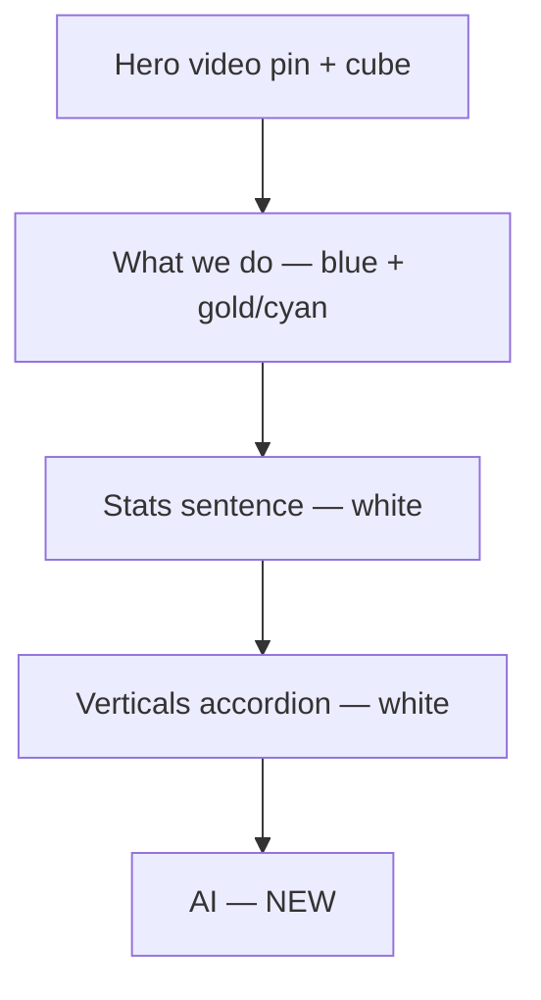

# AI band — on-brand design directions (02-video-hero)

## What Figma defines (content only)

Node [`11294:2`](https://www.figma.com/design/3oHvScSPrK5l6N1qfv9WCw/FS-Design?node-id=11294-2) is **section 05 — AI**, not a layout mandate:

| Slot | Figma / locked copy ([`content-slots.md`](content-slots.md) §2 row 05) |
|------|------------------------------------------------------------------------|
| H2 | **AI that already knows the business.** |
| Three examples | Forecasting that fits the trade · Back office, handled · Support that knows the industry |
| Link | **See AI at Fullsteam** → `embedded-offerings.html#ai` |

Constraints from discovery + art direction ([`homepage-art-direction.md`](03_Design/style-guide/homepage-art-direction.md) §7.5, KB §20.5): **use cases first**, proprietary **vertical data** as the differentiator, **never headcount reduction**, investor-primary lens, **gold = growth/AI** (one accent moment per viewport).

## Where it sits in the build

Current scroll in [`03_Design/explorations/02-video-hero/index.html`](03_Design/explorations/02-video-hero/index.html):

**Rhythm problem to solve:** two consecutive **white** bands (verticals → AI). Art direction already flags this ([§7.4](03_Design/style-guide/homepage-art-direction.md)): prefer a **10% Bio Blue tint** or warm tint on one band rather than merging visually. In this exploration, stay on the established chrome tokens (`--blue` `#003F55`, `--cyan` `#00BDFF`, `--gold` `#FEC50A`, ink `#0d1a20`) rather than introducing Tailwind or wireframe grey placeholders.

**Your motion choice:** static band — no scroll scrub, no pin, no accordion. At most a **~400ms fade-up** on first paint ([§6](03_Design/style-guide/homepage-art-direction.md) “quiet scroll reveals”).

---

## Design ideas (on-brand, matched to 02-video-hero)

Each idea keeps the **same three use cases + link**; they differ in **layout and imagery**, not IA.

### 1. Editorial triad (recommended primary)

**Best fit for the exploration’s existing type system** without copying the Figma card grid.

- **Canvas:** light band with a **subtle blue tint** (e.g. `#f4f8fa` or `color-mix` from `--blue` ~6–10%) so it separates from the white verticals block above.
- **Headline:** centered, **Instrument Sans 700**, `clamp(32px, 5vw, 56px)`, tracking ~`-0.03em` — same register as [`.verts__title`](03_Design/explorations/02-video-hero/index.html) (~524–529).
- **Accent:** one **Instrument Serif italic** gold phrase inside the H2 (e.g. *knows the business*) — mirrors hero payoffs (*software.* / *grow.*) and the stats sentence, without a fourth “big motion” moment.
- **Three use cases:** **stacked rows** (not columns): mono index `01 / 02 / 03` in **Fragment Mono**, bold sans title (20px), optional one-line descriptor in regular sans (16–18px, `#0d1a20` at ~75% opacity). Hairline rules between rows — same “engineered” language as `.vpanel__rule` / What we do spacing discipline.
- **Imagery:** **no equal grey tiles**. Either (a) small **UI crop** at the right of each row (fixed aspect, 12px radius, blue-shifted grade), or (b) **no image in v1** — type-only until real product shots exist (KB §18: avoid stock).
- **Link:** reuse [`.verts__all a`](03_Design/explorations/02-video-hero/index.html) pattern — centered, ink + bottom border, hover to `--blue` (validation site, not a second gold pill).

*Why it’s on-brand:* extends What we do / verticals typography; avoids SaaS “feature grid”; static; gold used once.

### 2. Single “proof frame” + caption strip

**One impressive visual instead of three competing placeholders** (aligns with “quiet confidence at scale” §1).

- **Layout:** centered **max-width ~960px** headline; below, **one wide frame** (~16:9 or 3:1) showing a **composite UI storyboard** (forecasting chart + back-office queue + support thread in one graded montage — one asset, three labeled zones).
- **Captions:** three **Fragment Mono** labels under the frame, evenly spaced — same words as Figma H3s, no cards.
- **Differentiator line:** optional short lede under H2 (content-slots allows intent copy): vertical data / industry context in plain 8th-grade language — **sans**, not a second display headline.
- **Link:** below captions.

*Why:* reads as **product credibility** for investors; fewer grey boxes; still static.

### 3. Asymmetric split (editorial / Bending Spoons sparse)

- **Left column (~40%):** H2 + underlined **See AI at Fullsteam** (sticky on desktop optional — keep subtle, no pin).
- **Right column (~60%):** vertical list of three use cases with **gold left rule** (2px) on the active/hover row only — pointer-free default: all rules equal weight at 30% gold opacity.
- **Type:** H2 left-aligned at large sizes breaks the “all centered” rhythm on purpose after two centered white sections — signals a **chapter change** toward “human / offerings” without a dark band.

*Why:* different silhouette from verticals accordion; still static; strong readability.

### 4. Full-bleed “UI band” (Square energy, exploration palette)

- **Three equal panels edge-to-edge** (like verticals stage **width: 100%**), but panels are **brand-blue planes** (`--panel` tones from `.vpanel[data-tone]`) with **white type on panel** for titles, not grey `#4a4a4a placeholders.
- **Content on panel:** use case title + one line; **no expand interaction** (static; user rejected focus/scrub).
- **Headline:** sits **above** the bleed strip in the 10% gutter, centered.

*Why:* keeps “show software” energy from the video hero thread; visually distinct from photo accordion above; still not the Figma wireframe look.

### 5. Imagery direction (shared across options)

Replace Figma placeholder grey with exploration-consistent media:

| Approach | Treatment | Deploy note |
|----------|-----------|-------------|
| **Product UI crops** | Cool blue shift, slight grid (reuse [`.hero__fallback`](03_Design/explorations/02-video-hero/index.html) hairline grid at low opacity) | Best for validation site; genericize until publishability |
| **Silent loop clips** | Same `<video>` patterns as hero (muted, pause control, `prefers-reduced-motion` → poster) | One clip per use case **or** one composite; do not hotlink copyrighted Square reference assets (see [`direction.md`](03_Design/explorations/02-video-hero/direction.md) Pages/stock notes) |
| **Diagram / schematic** | Line-art UI wire in **cyan** on white | Reads “engineered”; no fake metrics |

**Do not:** stock “AI brain” imagery, purple gradients, or headcount/efficiency claims ([`inspiration.md`](inspiration.md) G7).

---

## Recommended path for implementation

**Ship idea 1 (Editorial triad) on a tinted light canvas**, with type-only rows first and UI crops slotted when assets exist. It matches the fonts, spacing, and link chrome already in the file, solves **white-on-white**, honors **static** motion, and uses **gold once** on the headline accent.

Secondary exploration to compare internally: **idea 2** (single proof frame) if the CD wants a stronger “one visual” investor moment after the busy accordion.

---

## Implementation checklist (after you approve)

1. **Markup:** Add `<section class="ai" id="ai">` after `#investors` / `.scale` closes (~line 987 in [`index.html`](03_Design/explorations/02-video-hero/index.html)), before the menu block.
2. **CSS:** New block using existing tokens (`--gold`, `--blue`, `--mono-d`); padding aligned with `.verts` / `.stats` (roughly 96px vertical, gutter `--gutter` or 24px); optional `@media (prefers-reduced-motion: reduce)` disables fade-up only.
3. **Copy:** Wire exact Figma H3 strings + H2 + link; add HTML comment referencing Figma node `11294:2` (same pattern as What we do / verticals comments).
4. **Docs:** Short changelog entry in [`direction.md`](03_Design/explorations/02-video-hero/direction.md); **do not** change [`wireframes.md`](wireframes.md) or [`design.md`](design.md) unless structure/copy intent changes (track boundary).
5. **Preview:** Local static server from repo root; check 320 → 1920 for contrast and adjacent-band separation.

---

## Out of scope (unless you ask)

- Promoting video-pin / cube hero to locked grow morph (KB §23 — separate strategy decision).
- Final lede copy in `content-slots.md` (can add a placeholder `
` hidden until copy is locked).
- Great place to work / closing bands (later sections in homepage order).

---

## Live reference examples (mapped to each idea)

Use these as **layout/structure inspiration only** ([`inspiration.md`](inspiration.md) §0 — not approved visual direction). Prefer **client-flagged** peers where noted (KB §9 / §18).

### Idea 1 — Editorial triad (stacked rows, mono index, type-led)

| Reference | URL | What to steal |
|-----------|-----|----------------|
| **Linear** (homepage chapters) | [linear.app/homepage](https://linear.app/homepage) | Large section H2 + **product UI as proof**; sub-features as compact text with hairlines, not equal cards. Teardown: [PageProofer Linear](https://pageproofer.com/inspiration/precision-dark/linear/) |
| **PageHub “Features checklist”** | [pagehub.dev — features checklist band](https://pagehub.dev/blocks/features/checklist/features-checklist-band) | **Headline left, vertical checklist right** — same information density as three use cases without a 3-up grid |
| **Bending Spoons** (client-flagged) | [bendingspoons.com](https://bendingspoons.com/) | Sparse **stacked editorial sections**, generous vertical rhythm, one idea per scroll beat |
| **Quilt** (client-flagged) | [quiltsoftware.com — “How Quilt helps retailers”](https://quiltsoftware.com/) | Three **named capability blocks** (Tailored / Smarter operations / Accelerated growth) — parallel to forecasting / back office / support, but **text-first** not grey tiles |
| **Quilt Advantage** | [quiltsoftware.com/advantage](https://quiltsoftware.com/advantage/) | **“AI-powered platform” + vertical depth** messaging — closest narrative analog to “AI that already knows the business” for a portfolio holder |

**Contrast (avoid as layout):** Figma wireframe three grey placeholders — structurally fine for IA, not a design target.

### Idea 2 — Single proof frame + caption strip

| Reference | URL | What to steal |
|-----------|-----|----------------|
| **Stripe** (platform showcase) | [Kage — stripe gallery component](https://kage.design/component/stripe-gallery) | One **large product visual** + short supporting links/captions — “make the platform tangible” |
| **Stripe Payments** (page anatomy) | [Screenrove — Stripe Payments](https://screenrove.com/stripe/marketing/stripe-marketing-payments) | **One hero mock + alternating copy/UI sections**; good model for one composite frame with three labeled zones |
| **Sandbar (AML SaaS)** | [VASA — Sandbar split + layered UI mocks](https://inspiration.vasa.works/item/website-sections/sandbar-features-section-2) | **Collage of cropped UI fragments** in one visual field — reads “depth” without three equal cards |
| **Staaarter “Full-Bleed Workspace Band”** | [staaarter.com/feature-blocks](https://staaarter.com/feature-blocks) | Header + **full-bleed image band** + **three numbered captions** underneath |

### Idea 3 — Asymmetric split (headline + list)

| Reference | URL | What to steal |
|-----------|-----|----------------|
| **Raycast** (editorial grid) | [Kage — Raycast feature grid](https://kage.design/component/raycast-feature-grid) | **Oversized headline column + architectural grid rules** — premium tool catalogue, not marketing cards |
| **Sandbar** (same as above) | [VASA — Sandbar](https://inspiration.vasa.works/item/website-sections/sandbar-features-section-2) | **UI collage left, headline + two-column checklist right** |
| **Anthropic / Claude** (product overview) | [claude.com/product/overview](https://claude.com/product/overview) | **“Put Claude to work”** — role/use-case labels as scannable list (static version: no tabs). Editorial split on [anthropic.com](https://www.anthropic.com/) per [Fudge design notes](https://design.withfudge.com/share/anthropic.com-design) |
| **shadcn “Hero Left Trust”** (pattern library) | [shadcn.io — hero left trust](https://www.shadcn.io/blocks/hero-left-trust-compliance) | Generic but clear **left copy / right proof panel** split for enterprise SaaS |

### Idea 4 — Full-bleed colored UI strip (static panels)

| Reference | URL | What to steal |
|-----------|-----|----------------|
| **Square** (aspirational, already in [`inspiration.md`](inspiration.md)) | [squareup.com/us/en](https://squareup.com/us/en) | Mid-page **outcome row** (“Point of sale”, “Manage your team”, …) — scannable pillars; breakdown: [SaaS Pattern — Square](https://www.saaspattern.com/en/website-breakdowns/square) |
| **CodeFronts color-block accordion** | [codefronts.com — color block horizontal accordion](https://codefronts.com/navigation/css-accordions/color-block/) | **Gapless full-width color stripes** — closest visual cousin to your **verticals accordion**, but **static** (no expand) for AI |
| **02-video-hero verticals** (internal) | [`index.html` `#vertStage`](03_Design/explorations/02-video-hero/index.html) | Already ships **full-bleed panels + brand blue tones** — reuse panel tokens, drop interaction |

### AI / use-case packaging (content pattern, any layout)

| Reference | URL | What to steal |
|-----------|-----|----------------|
| **Notion AI** | [notion.so/product/ai](https://www.notion.so/product/ai) · [Screenrove breakdown](https://screenrove.com/notion/marketing/notion-marketing-ai) | **Named use-case modules** stacked as chapters (Agent / Search / Meeting notes) — not one generic “AI-powered” grid. **Ignore** whimsical illustration tone for Fullsteam |
| **SaaS Pattern — Notion** | [saaspattern.com — Notion](https://www.saaspattern.com/en/website-breakdowns/notion-so) | Job-to-be-done headlines + **UI vignette per module** |

### References to treat as **anti-patterns** for Fullsteam AI

- Generic **3-column equal card grids** with grey placeholders (Figma wireframe only).
- **Purple “AI brain”** marketing tropes (not in client palette; [`homepage-art-direction.md`](03_Design/style-guide/homepage-art-direction.md) §1 anti-goals).
- **Notion-style mascots / pastel playfulness** — wrong register for investor-primary validation site.
