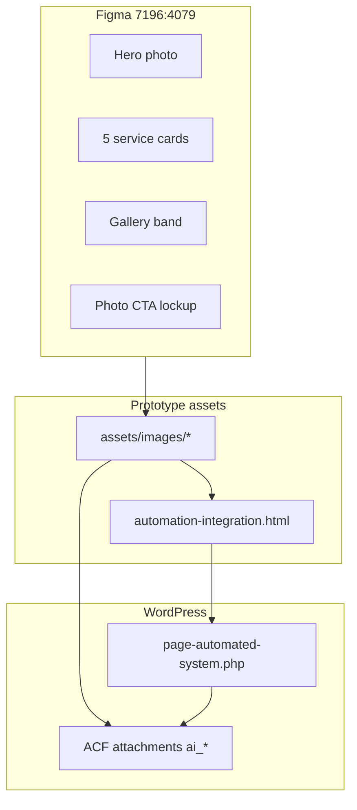

# Automation page — Figma `7196:4079` implementation plan

## What this frame is

[Figma `7196:4079`](https://www.figma.com/design/YgHwqyyFj57c1ZSbmfkL0c/Gerotech-Design?node-id=7196-4079) is **Automation and Controls Solutions** — maps to:

| Layer | Path |
|--------|------|
| Prototype | [`automation-integration.html`](automation-integration.html) |
| WordPress (live slug) | [`wp-content/themes/gerotech-child/page-automated-system.php`](wp-content/themes/gerotech-child/page-automated-system.php) → `/automated-system/` |
| ACF group | `group_automation_content` (`ai_*` fields in [`inc/acf-fields.php`](wp-content/themes/gerotech-child/inc/acf-fields.php)) |

Shared chrome (header, footer, testimonials, mailing list) already matches site patterns; this pass is **page-specific hero, service cards, gallery, CTA**.



---

## Current state vs frame (gaps)

### Already aligned (no structural work)

- **Layout:** `.page-hero` → `.mcs-grid-section` (5 cards) → `.mcs-gallery-section` → testimonials partial → `.cta-band--cinema-lockup` → `.email-signup`.
- **Service cards:** Same five titles as Figma (`7196:4291`–`7196:4323`); modal copy largely matches presentation notes in layer names.
- **CTA copy:** Eyebrow, headline, body, and phone lockup match Figma text nodes `7196:4411`–`7196:4432` (site uses **Talk to an Engineer** instead of Figma’s **Get a Quote** — intentional site-wide drift; do not revert unless client asks).
- **Testimonials:** Shared [`partials/testimonials-block.html`](partials/testimonials-block.html) — matches Figma section `7196:4361`.

### Photography — mostly done; one card still stand-in

| Slot | Figma layer / node | Target asset (comment-sourced) | Repo status |
|------|-------------------|--------------------------------|-------------|
| Hero | `7196:4264` Robotic automation cell | `assets/images/automation-hero.jpg` | Present |
| HMI Design card | `7196:4292` | `assets/images/hmi-design.jpg` | Present ([`asset-manifest.md`](handoff/asset-manifest.md)) |
| Layered Controls card | `7196:4300` | `assets/images/layered-controls.jpg` | Present |
| Automation Cell Design | `7196:4308` | `assets/images/automation-cell-design.jpg` | Present |
| Robot EOAT | `7196:4316` | `assets/images/robot-eoat.jpg` | Present |
| **Pre-Engineered Solutions** | `7196:4324` | **New file needed** (e.g. `pre-engineered-solutions.jpg`) | **Still Unsplash** in HTML + PHP default |
| CTA band | `7196:4404` | `assets/images/cta-rail-robot.jpg` (+ `@2x`) | Present; **shared with ES CTA** — only re-import `ai_cta_image` if Automation gets a *different* photo |

Figma still shows **“Stand-in: Unsplash”** labels on several layers; treat those as stale — the comment attachments you pulled are the source of truth.

### Copy / heading drift (choose once, then sync proto + `ai_*` defaults)

| Area | Figma `7196:4079` | Live prototype / WP default | Notes |
|------|-------------------|----------------------------|--------|
| Hero subcopy | Empty frame `7196:4280` (no body in wireframe) | Long `slide__body` / `ai_hero_body` | **Decision:** keep body (useful SEO/copy) unless client explicitly wants hero headline-only like the empty Figma container. |
| Hero accent | Visual in MCP screenshot: orange on **“Solutions”** only | Orange on **“Controls Solutions”** (`and <em>Controls Solutions</em>`) | Settled in [JOURNAL 2026-09-18](JOURNAL.md) per client — **keep “Controls Solutions”** unless this frame supersedes that. |
| Gallery eyebrow | **Project Gallery** (`7196:4336`) | **Gallery** (`ai_gallery_eyebrow`) | Prior comment pass (`7102:8937` #20) intentionally set eyebrow → **Gallery** — prefer comment resolution over stale Figma label. |
| Gallery title | **Installed Automation Projects** (`7196:4338`) | **Installed Automation *Gallery*** | JOURNAL shows back-and-forth; pick one client-facing string and use `<em>` on the accent word (`Projects` vs `Gallery`). |
| CTA trust chips | Figma list `7196:4422`–`7196:4428` | Removed site-wide | **Do not re-add** (2026-09-14 decision). |

### Gallery structure — important mismatch

- **Figma wireframe:** 5 gallery tiles (`7196:4340`–`7196:4359`) mirroring **service card titles** (placeholder photos).
- **Implemented site:** **7** installed-project collections under `assets/images/automation-gallery/01–07` with real captions (Haas cell, robot line, vision, EOAT shots, etc.) — from earlier client Downloads / comments on frame `7102:8937`.

**Recommended default (no questionnaire answer):** **Keep the 7-project gallery** and only update section titles/eyebrow and any refreshed JPEGs from comments. Switching to Figma’s 5-tile model would **remove** the installed-project story the client already approved.

If comment attachments include **replacements** for `01–07`, overwrite files in place (same filenames) so gallery `media` lines in PHP stay valid.

---

## Implementation steps

### 1. Land comment images in the repo

- Drop any new files into [`assets/images/`](assets/images/) (and `automation-gallery/` if project shots changed).
- **Must-do:** add `pre-engineered-solutions.jpg` (or agreed name) and replace the Unsplash URL in:
  - [`automation-integration.html`](automation-integration.html) (~line 119)
  - Default row in [`page-automated-system.php`](wp-content/themes/gerotech-child/page-automated-system.php) (`ai_cards` index 4)
- Update [`handoff/asset-manifest.md`](handoff/asset-manifest.md) with dimensions/source node for each new asset.
- HTML comments on each ``: client photo + Figma node id when known.

### 2. Copy pass (proto only if strings change)

- If locking gallery title to Figma: set eyebrow/title in HTML and matching ACF defaults, e.g. `ai_gallery_eyebrow` / `ai_gallery_title` with `<em>Projects</em>` or `<em>Gallery</em>` per decision above.
- Do **not** change CTA button to “Get a Quote” without explicit client direction.

### 3. Sync assets into the child theme

```bash
./scripts/sync-theme-assets.sh
./scripts/sync-theme-to-local.sh
```

### 4. Apply WordPress stored media (required for cards/hero)

Stored `ai_cards` / `ai_hero_image` / `ai_cta_image` **override** template defaults ([`.clinerules`](.clinerules) — “Card images — two halves”).

```bash
# Hero (only if hero file changed)
wp eval-file scripts/set-page-image.php "automated-system" "ai_hero_image" "assets/images/automation-hero.jpg"

# Each service card that changed (idempotent)
wp eval-file scripts/set-card-image.php "automated-system" "ai_cards" "HMI Design" "assets/images/hmi-design.jpg"
wp eval-file scripts/set-card-image.php "automated-system" "ai_cards" "Layered Controls Solutions" "assets/images/layered-controls.jpg"
wp eval-file scripts/set-card-image.php "automated-system" "ai_cards" "Automation Cell Design" "assets/images/automation-cell-design.jpg"
wp eval-file scripts/set-card-image.php "automated-system" "ai_cards" "Robot EOAT – Ancillary Material Handling" "assets/images/robot-eoat.jpg"
wp eval-file scripts/set-card-image.php "automated-system" "ai_cards" "Pre-Engineered Solutions" "assets/images/pre-engineered-solutions.jpg"

# CTA — run ONLY if Automation gets its own photo (not shared rail-robot)
# wp eval-file scripts/set-page-image.php "automated-system" "ai_cta_image" "assets/images/cta-rail-robot.jpg"
```

**Gallery collections:** paths live in `ai_collections` `media` textarea defaults + DB. If only JPEG bytes changed, syncing assets may be enough. If titles/meta/paths change, update the default array in `page-automated-system.php` and either re-seed those fields or edit in WP admin — mirror the Applications pattern ([`scripts/add-app-gallery-items.php`](scripts/add-app-gallery-items.php)) if you add a similar helper for `ai_collections` (optional; hand-editing defaults + DB update is fine for small changes).

If gallery copy fields change, add keys to [`scripts/seed-acf-content.php`](scripts/seed-acf-content.php) (field **keys**, not names) so Local/Dev editors show applied values.

### 5. Deploy and repeat on Dev

- `rsync` child theme only to `gerotechdev` (see [`CLAUDE.md`](CLAUDE.md)).
- Re-run card/hero scripts on Dev; `wp page-cache flush` + `wp cdn-cache flush`.
- `wp eval-file scripts/audit-acf-applied.php` — confirm no accidental blank overrides on `ai_hero_accent_color` (should stay blank = orange).

### 6. Verification

- **Prototype:** http://localhost:8080/automation-integration.html — 0 broken images, Pre-Engineered no longer Unsplash, hero + cards match comment art.
- **Local/Dev:** `/automated-system/` — same card photos in grid **and** modals; breadcrumb plain text (`strip_tags` on headline fields already correct in PHP).
- **Crop check:** card images are ~560×275 (~2.04:1); preview with `sips -c` if any comment photo is portrait ([`.clinerules`](.clinerules) MCS card crop note applies to Automation cards too).
- **Shared CTA:** spot-check ES CTA still serves `@2x` if you touched `cta-rail-robot` files.

### 7. Session hygiene

- Prepend [`JOURNAL.md`](JOURNAL.md); update **Current Session State** in [`.clinerules`](.clinerules).

---

## Out of scope for this frame

- Figma header **Get a Quote** vs site **Talk to an Engineer** (global nav decision).
- Re-adding CTA trust chips removed in 2026-09-14.
- ES hub or other pages unless comment images accidentally target wrong frame (watch for MCS copy pinned on wrong frames — called out in JOURNAL).

---

## Summary checklist

| Task | Priority |
|------|----------|
| Replace Pre-Engineered Unsplash with comment image | **Required** |
| Confirm hero + 4 other card JPEGs match latest comment exports | High |
| Refresh `automation-gallery/01–07` if new project photos in comments | High (if provided) |
| Resolve gallery title/eyebrow string (Projects vs Gallery) with client or use comment #20 resolution | Medium |
| `set-card-image` / `set-page-image` on Local + Dev | **Required** after asset changes |
| sync-theme-assets + deploy Dev | **Required** |
