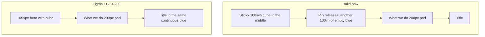

# Cube → What we do gap

The awkward air is mostly **leftover sticky hero**, not the Figma composition.

In the build, after `--cube` hits 1 the hero is still a **sticky `100svh` slab** with a 210px cube in the middle. The pin then has to fully leave before [`.what-we-do`](03_Design/explorations/02-video-hero/index.html) (`padding: 200px`) starts. That is a whole extra viewport of empty `#003F55` plus 200px more.

Figma **`11264:200`** (page 1440×2648) is one continuous blue field:
- Hero band is **1059px** (not a second sticky 100vh after collapse), cube **210×210** at `top: 424.5` (vertically centred-ish), radius 28, shadow `0 34 80 rgba(0,12,20,.5)` — same as the build.
- What we do is the next sibling, same `#003F55`, **`py: 200px`**.
- Cube bottom → title is ~**624px** of blue in the file, but because the hero is only 1059px you already see cube **and** the start of the title in one laptop frame. The build never does: the sticky 100vh has to exit first.

## Options (pick one)

**1. Shorten the hero after collapse (closest to Figma)**  
Once `--cube ≈ 1`, drop `.hero` from `100svh` to a short band (~cube + ~180–240px, or Figma's remaining ~1059px → treat as ~min(100svh, 1059) only during collapse, then shrink). Pin releases a small cube-block, not a full viewport. Keep What we do `padding-top: 200px` or trim it to ~80–120px so the title sits under the cube like the screenshot. Modest JS: after cubing, set a class `.is-cubed` that changes hero height.

**2. Overlap: title enters under the still-centred cube**  
Negative margin / pull What we do up so cube and “What does Fullsteam do?” share the viewport (the Figma screenshot crop). Cube stays 210 in the upper third; title lands in the lower half. Strongest “one page” read. Risk: fights the Bending Spoons word-blur (title starts below the 42% focus line).

**3. Cube docks up, then type**  
After collapse, translate the cube toward `top` (below the header) so the empty lower 100vh is available for the incoming title. Not what Figma draws (cube stays mid-hero), but it kills the hole.

**4. Cube is the first object of What we do**  
End the pin as soon as the cube lands; the cube scrolls away as a small card and the title follows with a designed gap (~64–96px), no 200px pad. Simplest. Cube does not linger as a chapter.

**5. Fade the cube out as the section arrives**  
Keep the pin, but opacity/scale the cube to 0 as What we do’s top crosses a threshold. Gap is still there; you just stop staring at a tiny video in a field of blue.

## Recommendation

**1**, maybe with a slightly tighter What we do `padding-top` (120px, not 200). That matches Figma’s one blue stage and the screenshot (cube, air, title in one view) without inventing a dock or a fade. Word-blur can stay: once the title is in the upper half it sharpens.

Do not build until you pick. Exploration only — [`03_Design/explorations/02-video-hero/index.html`](03_Design/explorations/02-video-hero/index.html), changelog in `direction.md`. No `design.md` / wireframe edits.
