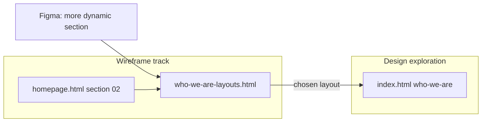

# Figma review — continue in repo

## Context

- **Source frame:** [FS-Design `11362:2306`](https://www.figma.com/design/3oHvScSPrK5l6N1qfv9WCw/FS-Design?node-id=11362-2306) (Exploration 02 · Video hero).
- **Already done in repo:** Scale and verticals typography in [`03_Design/explorations/homev2/index.html`](03_Design/explorations/homev2/index.html) + note in [`direction.md`](03_Design/explorations/homev2/direction.md) (2026-10-23).
- **Boundary:** You paste HTML → Figma; we do not sync Figma via MCP. Polished build stays **homev2**; structure iteration for “more dynamic” section belongs on the **wireframe** track per [`AGENTS.md`](AGENTS.md).

## Comment status (what we can still do in-repo)

| Pin (Figma) | Repo action |
|-------------|-------------|
| Header — two nav options | **Reference only:** [`02_Wireframes/active/header-wireframe.html`](02_Wireframes/active/header-wireframe.html) already compares chrome; homev2 open menu is **single-column rows** (`.menu__panel .menu__inner { display: block }`) while footer uses **4-column** `.menu__inner`. Document both in tracker; no sitemap change. |
| Homepage hero — sample video | **Brief + hook only:** document vertical/payments criteria in homev2 `direction.md`; keep `hero-stock.mp4` until client clip; re-run hero contrast sampling when swapped ([`ada-audit.md`](03_Design/explorations/homev2/ada-audit.md) residual risk #1). |
| Section below hero — gradient AA | **Document:** HTML already restricts gold→green gradient `em` to **dark grounds**; `.ai__title em` uses solid `--green-ink` on light wash. Cite measured ratios from [`ada-audit.md`](03_Design/explorations/homev2/ada-audit.md) in tracker for Figma paste. |
| Section below hero — more dynamic layout | **New low-fi wireframe page** (your choice): iterate layouts without touching homev2 polish. |
| Scale and verticals — font | **Done** in homev2. |
| Scale and verticals — images | **Blocked** on client photography; keep Unsplash URLs + attribution comment block; list ask in tracker. |
| Section above Careers — AA | **Verify + note:** likely [`#founders`](03_Design/explorations/homev2/index.html) (photo + horizontal scrim) or [`#careers`](03_Design/explorations/homev2/index.html) (blue band + gradient `em`). Quick contrast pass on quote, lede, and gold `em`; tighten scrim only if a spot fails 4.5:1. |
| Careers — real LinkedIn posts | **Structure for swap-in:** keep carousel; label cards as client-fill slots; optional short `linkedin-slots.md` with fields (date, body, image URL, link) — no fabricated “real” copy. |

## Primary deliverable: low-fi “What we do” layout lab

Add **[`02_Wireframes/active/who-we-are-layouts.html`](02_Wireframes/active/who-we-are-layouts.html)** — same visual language as [`header-wireframe.html`](02_Wireframes/active/header-wireframe.html) (white/tan, black rules, intent + `.anno`, no brand polish).

Show **3–4 stacked options** on one scrollable page, each labeled:

1. **Baseline (canonical wireframe)** — mirror current [`homepage.html`](02_Wireframes/active/homepage.html) `#what-we-do`: three steps + founder band + voice (structure only).
2. **Sticky rail (homev2 direction)** — schematic: left scroll steps / right sticky photo + caption (matches homev2 `#who-we-are` intent without video or motion).
3. **Tabbed / one-at-a-time** — Acquire · Grow · Lead tabs; one content panel + one image slot (addresses “more dynamic” without scroll-jacking).
4. **Horizontal accordion** — three columns or a row of cards; one expands inline (optional fourth if it fits one screen of annotation).

Each option includes:

- Locked content slots: **01 Acquire / 02 Grow / 03 Lead**, metric placeholders, founder CTA pointer to Acquisitions (not in header).
- Annotations tying back to KB §20 (software → verticals → payments order; no exit framing).
- A one-line “Figma comment addressed” note on options 3–4.

Update **[`wireframes.md`](wireframes.md)** changelog + a short pointer under homepage section 02 (OI-style note: layout variants live in the new file; homev2 remains the visual exploration).

## Secondary deliverable: comment tracker for Figma paste

Add **[`03_Design/explorations/homev2/figma-review-2026-10-23.md`](03_Design/explorations/homev2/figma-review-2026-10-23.md)**:

- Table of all 8 comments → **status** (done / in wireframe lab / blocked / verify).
- **Paste-ready blurbs** for contrast pins (hero tint, gradient `em` rule, careers/founders).
- Explicit **out of scope in repo:** client video, real LinkedIn text, final vertical photography.
- Link to [`ada-audit.md`](03_Design/explorations/homev2/ada-audit.md) as implementation proof.

One line in [`direction.md`](03_Design/explorations/homev2/direction.md) pointing to this file.

## Small homev2 checks (only if verification fails)

- Founders band: sample contrast at worst scrim (right side of photo); if quote or lede drops below 4.5:1, bump left scrim stop in `.founders` background gradient only (minimal diff).
- LinkedIn module: ensure visible “client to supply posts” note near `#careersPosts` (HTML comment + optional mono footnote under carousel).

## Explicitly not in this pass

- No change to locked homepage opening (Axis A → morph → Axis B).
- No new Figma MCP / comment API work.
- No promotion of homev2 to wireframes or client-facing docs.
- No commit unless you ask.

## How you’ll use it

1. Iterate layout options in **who-we-are-layouts.html** (browser: `python3 -m http.server 8000` → `/02_Wireframes/active/who-we-are-layouts.html`).
2. Paste updated **homev2** into Figma when ready; attach **figma-review-2026-10-23.md** blurbs as pin replies or frame notes.
3. Pick a wireframe option → then we implement that structure in homev2 in a follow-up task.
