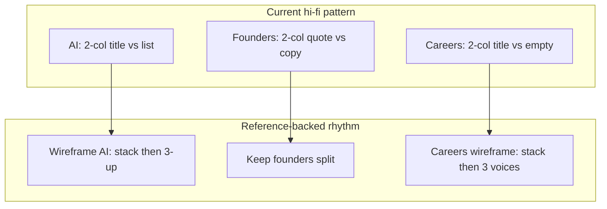

# Homepage design revisions: typography and layout

These recommendations come from reviewing [03_Design/client-review/homepage/index.html](03_Design/client-review/homepage/index.html) against its [design-notes.md](03_Design/client-review/homepage/design-notes.md) and the governance in KB §15, §23 and §27. None of them change the locked opening model, which is Axis A, then the grow morph, then Axis B.

## Client feedback (2026-11-02)

**The scale chapter is approved as built.** The client likes the current **“How a Fullsteam company *compounds.*”** band (`#scale`, `.chapter.approach` — Acquire → Grow → Lead three-up, process runner, staggered step reveal, closing stat row, dark chapter treatment).

**Do not propose or ship layout or composition changes to this section** unless fixing a verified bug (overflow, contrast failure, or WCAG blocker). Typography token work (T2–T5) may **align CSS variables** behind the same computed sizes — not a visible redesign.

When this feedback is executed into repo records, log it in [`design-notes.md`](03_Design/client-review/homepage/design-notes.md) and KB (decision log / §28 area).

## Typography

**T1. Instrument Serif is approved (2026-11-02); now give it rules.** Record the approval in KB §27.4 and in AGENTS.md, which currently says the serif is not sanctioned. The serif is used in eight places (lines 140, 534, 779, 976, 1308, 1346, 1381, 1449). Define a `--serif` token and a usage rule: italic, weight 400, letter-spacing 0, used for single emphasis words and quotes only, never for a full heading or body text. Then check each of the eight uses against that rule. The opening tagline (line 140) is a full sentence in serif, so it is the one most likely to break the rule.

**T2. Display sizes don't follow the scale.** The `--display-xl` to `--display-xs` tokens exist (lines 65 to 69), but many headings use their own `clamp()` values instead: lines 774, 849, 885, 1091, 1097, 1309 and 1342. The fix is to map each to the nearest token — **except `#scale` / `.approach`**, where token values must match current computed sizes so the approved band looks unchanged (lines 774, 849, 885 are in this section).

**T3. Monospace labels are too small.** Labels are set at 10px, 10.5px and 11px (lines 503, 519, 844, 1336, 1443, 1456, 1513), and 1066 drops to 11.5px. Options:
- set a floor of 12px with roughly .08em tracking;
- or use one `--label` token at 12px desktop and 11px mobile minimum.

**T4. Letter-spacing varies at every size.** Display tracking ranges from -.02em to -.045em, and weights mix 500 and 700 for the same role (stats heading at 500, others at 700). Proposed fix: tie tracking to size (xl -.04em, l/m -.03em, s/xs -.02em) and pick one display weight.

**T5. Body copy is several slightly different sizes.** Body text appears at 13.5, 15, 16, 17 and `clamp(18–21)` px. The fix is two tokens: `--body` at 17px with 1.5 line-height, and `--lede` at `clamp(18px,1.4vw,21px)`. This also supports the 8th-grade readability goal in KB §20.

**T6. The hero line-height is 0.95.** The serif line uses `line-height:0` as a workaround (lines 522 to 608), which means the blur and clip offsets have to be tuned by hand. Option: move to 1.0, give the serif its own measured line box, and remove the per-line padding workarounds.

## Layout

**L1. Off-palette colours (high priority, OI-13).** `--blue:#003F55` and the vpanel tones `#005978`, `#002C3C`, `#0a4a5c` and `#1a4554` (lines 85, 1027 to 1031) are not in KB §15. The fix is to derive the dark grounds from `--brand` with `color-mix`, the same way `--hero-dark` already is.

**L2. The page has three content widths and two gutter systems.** Chapters, AI and careers use 1200px, the stats heading uses 1160px, and the verticals section uses its own `--gutter:100px/40px/24px` instead of `--gutter-x`. Proposed fix: one `--content-max:1200px`, with `--gutter-x` used everywhere. **Exception:** if `#scale` uses 1160px intentionally for the headline measure, keep that visual width when unifying (variable alias, not a layout shift).

**L3. Too many sections use the same two-column split.** AI, founders and careers are all heading on the left, body on the right (1fr/1fr, 1.1fr/.9fr). Options to vary the rhythm:
- give AI a full-width heading with a 4-up list underneath;
- keep founders as a split;
- give careers a stacked heading with the testimonials as the visual.

**L4. Vertical spacing is inconsistent.** `--section-y` exists, but sections set their own padding (for example the founders band at `clamp(96px,14vh,168px)`). Proposed fix: two steps, `--section-y` and `--section-y-lg`, with the large step reserved for the founders and close bands.

**L5. Button shape is still unresolved (OI-12).** The site uses a 999px pill, while the wireframes use 0 and Figma uses a pill. This needs a decision to lock the Button spec. The pill is recommended because it already matches Figma.

**L6. The verticals accordion labels shrink at 1200px and below.** At 1200px the labels drop to 11.5px with tracking 0 (line 1066). Options:
- switch to a stacked list below 1200px instead of below 1023px;
- or shorten the labels.

**L7. Mobile stats in `#scale` — deprioritized (client lock).** Below 900px the closing stat numbers are large with a left indent; that was flagged in review, but **the section composition is client-approved**. Do **not** redesign the scale chapter for mobile as part of this pass. Only revisit if device QA shows overflow, unreadable type, or an a11y failure — and then limit changes to the smallest fix (e.g. one breakpoint tweak), not a 2-up grid or new stat layout.

**L8. Accessibility hasn't been audited yet.** The design notes say axe has not been run, and WCAG 2.2.2 (pause control) was dropped. Both should be closed before any typography change is signed off.

## Visual references for layout improvements

Study **structure and interaction only** — same rule as [`inspiration.md`](inspiration.md) §0 (no palette, type, or radii lifted from references). Prefer **client-flagged** sites (KB §9) and **in-repo wireframes** before adding new external URLs. When a reference is used in a build pass, add a short §2.x entry to `inspiration.md`.

### L2 — One content max-width and one gutter system

| Reference | URL / path | What to screenshot or inspect | Borrow | Ignore |
|-----------|------------|--------------------------------|--------|--------|
| **TogetherWork** (client-flagged) | [togetherwork.com](https://togetherwork.com) | Main column width; how sections align to the same left edge through the scroll | Single readable measure; verticals block sits in the same grid as hero and footer (KB §9: “clean look & feel”) | Stock photography; any “platform” framing (G1) |
| **Frontier Growth** (client-flagged) | [frontiergrowth.com](https://frontiergrowth.com) | Homepage **content blocks** — stacked bands with consistent horizontal inset | Discrete chapters with one gutter per band (KB §9) | Dated typography; hero video as a visual direction |
| **Internal — wireframe `.wrap`** | [`02_Wireframes/active/homepage.html`](02_Wireframes/active/homepage.html) | Shared `.wrap` on every section | Proof that the project already assumes one inner column (1120px in wireframes → 1200px in hi-fi is a small harmonization) | Lo-fi skin |
| **Internal — calm-canvas study** | [`03_Design/explorations/README.md`](03_Design/explorations/README.md) (`homev3/` — Asana register, gitignored) | Section padding rhythm on a **single canvas** | Two-step vertical rhythm without one-off band padding | Not client-facing; do not copy Asana type/colour |
| **Figma token source** | FS-Design `Fullsteam Brand` (KB §27) | Frame widths on official components | Align `--content-max` with Figma page margins when reconciling OI-12/OI-13 | Explorations (internal) page palette |

### L3 — Break the repeated two-column split (AI / founders / careers)

| Reference | URL / path | What to inspect | Maps to option | Ignore |
|-----------|------------|-----------------|----------------|--------|
| **In-repo wireframe — AI** | [`02_Wireframes/active/homepage.html`](02_Wireframes/active/homepage.html) `#ai` | Full-width H2 + lede + **3-up `.ucases`** under one `.wrap` (not side-by-side with the list) | **AI:** full-width heading + numbered grid below (already ratified in wireframe record) | Dark-band styling as final colour |
| **Official build — founders** | [`03_Design/client-review/homepage/index.html`](03_Design/client-review/homepage/index.html) `#for-founders` | Quote column + copy column with retail frame | **Founders:** keep split; refine proportions only | — |
| **Quilt** (client-flagged) | [quiltsoftware.com](https://quiltsoftware.com) | Hero → **horizontal stats band** → brand grid → mission copy blocks | **Careers:** headline + proof first, then a **visual row** (stats or logos) as the “hero” of the band — analog to stacked heading + testimonials as visual | Their KPI copy ($9B+ etc.) — use allowlisted placeholders only (G4) |
| **Quilt Spotlight** | [quiltsoftware.com/spotlight](https://quiltsoftware.com/spotlight) | Values + **long-form quote cards** with attribution | **Careers:** testimonials as the primary visual after a short intro stack | Named employee stories until publishability confirmed (G5) |
| **In-repo wireframe — careers** | [`02_Wireframes/active/pages/careers.html`](02_Wireframes/active/pages/careers.html) `#voices` | **Three-up `.voices`** with vertical dividers; stacks to bordered rows on mobile | **Careers:** heading block → **3 testimonial columns** (matches 2026-10-29 build intent) | Placeholder quotes |
| **Localyzer About** (partial study) | [localyzer.io/about](https://www.localyzer.io/about) — patterns in [`inspiration.md`](inspiration.md) §2.1 | Split intro + team row + chapter cards | Alternate rhythm: one split, then full-width card row | Demo CTAs; company story deprioritized vs Fullsteam (G6) |

### L4 — Section vertical spacing (two steps)

| Reference | URL / path | What to inspect | Borrow | Ignore |
|-----------|------------|-----------------|--------|--------|
| **Bending Spoons** (superseded guide) | [bendingspoons.com](https://bendingspoons.com) | Long-form **chapter stack** — each chapter feels like a “turn of the page” | Map `--section-y` vs `--section-y-lg` to “standard chapter” vs “breathe-out” bands (founders, close) — see [`inspiration.md`](inspiration.md) §2.3 | Portfolio-as-homepage IA; deal cards on homepage |
| **Frontier Growth** | [frontiergrowth.com/why-frontier/tailored-approach-value-add](https://frontiergrowth.com/why-frontier/tailored-approach-value-add) | Value-add page block spacing | Consistent **inter-block** gap without custom per-section `clamp()` | Font / dated chrome |
| **Square chapter beats** | [squareup.com/us/en](https://squareup.com/us/en) | Distance between major bands after the opening pin | One default section pad + **one enlarged** pad before credibility closes | Square palette; industry stats in cards |

### L6 — Verticals accordion: labels vs stack breakpoint

| Reference | URL / path | What to inspect | Borrow | Ignore |
|-----------|------------|-----------------|--------|--------|
| **Square audience moment** | [squareup.com/us/en](https://squareup.com/us/en) — documented in [`inspiration.md`](inspiration.md) §2.2 | Below **~1024px**, equal **collapsed bars** (~5rem) with one panel expanded (~80svh) — labels stay readable without shrinking type | **Option A:** collapse to stack **earlier (1200px)** instead of shrinking label type to 11.5px | Cursor decoration; per-industry stats; four-industry taxonomy |
| **TogetherWork** | [togetherwork.com](https://togetherwork.com) | How verticals appear on homepage **without child pages** | List / card names always legible at medium widths (KB §9) | Stock imagery |
| **In-repo — Vertical Software wireframe** | [`02_Wireframes/active/pages/vertical-software.html`](02_Wireframes/active/pages/vertical-software.html) | Sticky **sidebar list** of 11 names + inline story | **Option B:** at mid breakpoints, switch accordion to **sidebar + panel** (same IA as interior page) | Modal/tile picker patterns (retired) |
| **In-repo wireframe — homepage vertical rows** | [`02_Wireframes/active/homepage.html`](02_Wireframes/active/homepage.html) `#verticals` | `
` **`.vrow`** summaries with full name in summary line | Stack-friendly pattern: name always in the summary, detail panel below | Placeholder stats in rows |

### L7 — Mobile stats band (scale chapter) — **on hold**

Client approved the full **“How a Fullsteam company compounds.”** section (2026-11-02). The references below are **archived for QA-only use** if mobile overflow is confirmed — not active layout direction.

| Reference | URL / path | Notes |
|-----------|------------|--------|
| **Official build — `#scale`** | [`03_Design/client-review/homepage/index.html`](03_Design/client-review/homepage/index.html) `#scale` | **Reference implementation** — treat as the pattern to preserve (3-column steps, runner, closing stats). |
| Quilt / Localyzer / `.facts-4` | (see prior plan) | Do not apply to `#scale` without a new client ask. |

### L1 and L5 (layout-adjacent — minimal external refs)

- **L1 (brand-derived darks):** Use existing **`--hero-dark`** / Bio Blue tints in Figma `Fullsteam Brand` (KB §15) — no reference site; avoid copying exploration `#003F55` (OI-13).
- **L5 (button radius):** Figma **Button** component on FS-Design `Design System` page vs wireframe `radius:0` — internal spec only ([`inspiration.md`](inspiration.md) OI-12).

### Practical review workflow

1. Open local build: `python3 -m http.server 8000` → `http://localhost:8000/03_Design/client-review/homepage/index.html`.
2. Side-by-side at **1440, 1200, 1024, 900, 390** with Square (verticals stack) and wireframe homepage (AI + careers structure).
3. Try layout diffs in [`03_Design/explorations/homev5/`](03_Design/explorations/homev5/) (sandbox fork of official homepage) before editing client-review.
4. Capture **annotated screenshots** (Framelink/Figma or repo `03_Design/assets/reference/` — **gitignored** for third-party captures; do not commit Square video or copyrighted shots).

## Decisions needed from the client or KB
- L5: the Button radius.
- L1: confirm that brand-derived dark tones are acceptable.

## Process
Make the changes on the official build only. Log each one in `design-notes.md`, and record the typography decisions in KB §27. Per AGENTS.md, don't change the wireframes or `design.md` unless that is explicitly agreed.