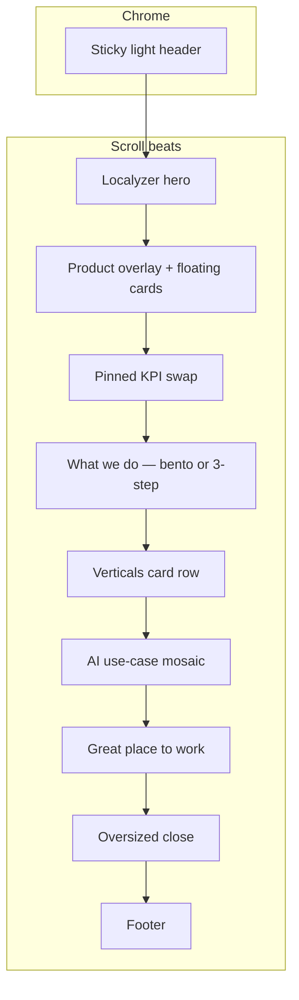

# homev4 — Localyzer-inspired homepage exploration

## Goal

Add a **brand-new exploration** (separate from [`homev2/`](03_Design/explorations/homev2/index.html)) that borrows **structure and rhythm** from [localyzer.io](https://www.localyzer.io/), documented in [`inspiration.md`](inspiration.md) §2.1 — **not** their SaaS conversion chrome, visual brand, or IA.

Your choices (confirmed):

- **Hero:** Localyzer-style (audience kicker + outcome headline + CTA) — **no** Axis A/B grow morph in this sandbox.
- **Depth:** **Full homepage** beats in wireframe order (KB §24 / [`wireframes.md`](wireframes.md) §2): Opening → What we do → Verticals → AI → Great place to work → Close (+ header/footer).



## What we take vs reject (from inspiration §2.1)

| Take (layout) | Reject (do not ship) |
|---------------|----------------------|
| Audience kicker above H1 | Book a Demo / overlay lead form |
| Proof early (optional logo/scale strip under hero) | “Platform” / six-up SaaS feature grid as the story |
| One **pinned mosaic** cycling 2–3 **allowlisted** KPIs | Localyzer teal/yellow visual system |
| Bento tiles for benefits / steps | Adoption-style “locations use it” framing |
| Named-but-genericized quote + photo after product beats | Newsroom filmstrip (off sitemap) |
| Oversized close + slim footer | Repeated “Get started” in every beat |

**CTA:** primary stays **Explore our vertical solutions**; secondary can anchor to `#what-we-do` (“How it works”) — not a demo.

**Type / color:** official **Fullsteam Brand** tokens (KB §15 / Figma): Bio Blue `#00587C`, Gold `#FFC600`, Instrument Sans + Fragment Mono — white/off-white canvas like Localyzer’s **spacing and density**, not their palette.

## Deliverables (new files only)

| Path | Purpose |
|------|---------|
| [`03_Design/explorations/homev4/index.html`](03_Design/explorations/homev4/index.html) | Single static page — all CSS/JS inline or in-file; internal banner |
| [`03_Design/explorations/homev4/direction.md`](03_Design/explorations/homev4/direction.md) | Self-contained brief: Localyzer mapping, take/ignore, token table, open questions |
| [`03_Design/explorations/homev4/assets/`](03_Design/explorations/homev4/assets/) | Copy [`fullsteam-logo.svg`](03_Design/explorations/homev2/assets/fullsteam-logo.svg) (and light variant if header is white); reuse [`hero-stock.mp4`](03_Design/explorations/homev2/assets/hero-stock.mp4) only if cinematic beat needs video — otherwise Unsplash full-bleed stills |

**Board entry:** add a card under “Exploration sets” in [`03_Design/explorations/index.html`](03_Design/explorations/index.html) linking to `homev4/` (does **not** change the “official” homev2 card).

**Out of scope (unless you ask later):** editing [`design.md`](design.md), [`wireframes.md`](wireframes.md), promoting to official direction, or updating [`inspiration.md`](inspiration.md) (optional one-line “homev4 implements §2.1 take list” in `direction.md` is enough).

## Section build notes (content = wireframe intent / placeholders)

1. **Header** — Option B revised pattern: logo · hamburger drawer · gold pill CTA; **light sticky bar** with `--bar-solid` on scroll (simple threshold, no homev2 hero coupling).

2. **Hero (Localyzer)** — Mono kicker (founders/investors lens, no lead-gen tone) → large balanced headline → one-line sub → primary + secondary CTAs → optional “Trusted by…” + **generic** proof strip (no unpublished logos without placeholders).

3. **Cinematic beat** — Full-bleed lifestyle/operations photo + **floating UI cards** (adapt copy: e.g. vertical, scale, payments — static chips, no fake product screenshots with real data).

4. **Pinned stat mosaic** — ~200–280vh pin; center stat cycles **allowlisted** figures (e.g. 11 verticals, 70,000+ customers, $75B payment volume placeholders per OI-5); left/right labels echo Localyzer’s Launch/Location/Template/Budget **structure** with Fullsteam labels (Acquire / Grow / Lead).

5. **What we do** — Four-tile **bento** (Efficient scale / Embedded advantage / Software-first / Category leadership) **or** three large step tiles matching Acquire → Grow → Lead; include founder CTA band + genericized quote (G5).

6. **Verticals** — Reuse interaction model from current exploration: eyebrow + headline + **five-card row** (selected un-dims) + 11 text links; white band.

7. **AI** — Dark band, **3-tile** mosaic (not six-up SaaS grid): use cases first, link to Our Advantage / AI card.

8. **Great place to work** — Three photo placeholders + Careers CTA; LinkedIn strip as lo-fi slots (same as homev2 note).

9. **Close** — Large type + primary CTA + quiet Acquisitions link.

10. **Footer** — Four-column tree (match homev2 IA); no Localyzer legal copy.

## Interaction / a11y

- Pin progress: **per-frame writes**, no CSS transitions on scroll-driven values (same rule as KB §23.6 for morph — applies to pin opacity/stat swaps).
- `prefers-reduced-motion`: pinned sections become **in-flow stacks**; stats shown as static trio.
- Skip link, focus rings, semantic headings; run a quick axe pass and note in `direction.md` (full audit optional follow-up).

## Preview

```bash
python3 -m http.server 8000
# → http://localhost:8000/03_Design/explorations/homev4/index.html
```

## Git

Explorations are often gitignored; **homev2 is now tracked**. After you approve the build, decide whether to **commit homev4** with the board link (same as recent homev2 commit) or keep local-only per [`README.md`](03_Design/explorations/README.md).
