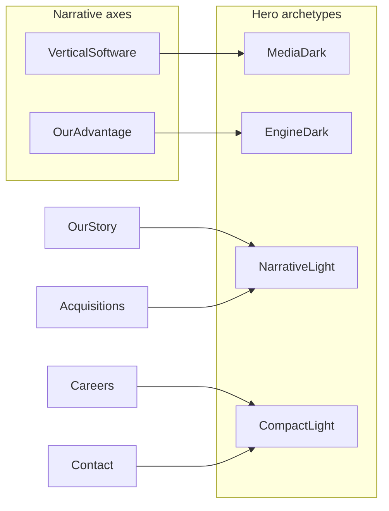

# Interior hero differentiation strategy

## Problem (current state)

The two shipped hi-fi subpages copy the same template:

- [`vertical-software.html`](03_Design/client-review/homepage/vertical-software.html) and [`our-advantage.html`](03_Design/client-review/homepage/our-advantage.html) both use `.hero` + `hero__glow` + 12-column `hero__row` (H1 cols 1–8, lede cols 9–13), `display--xxl`, gold `em` payoff, identical ink gradient and blue/gold radial glow — only headline/lede copy differs.

Wireframes already hint at differentiation that hi-fi flattened:

- **Vertical Software** wireframe: [`v-hero`](02_Wireframes/active/pages/vertical-software.html) + content-slots **customer photo + two product screenshots in hero** ([`content-slots.md`](content-slots.md) §5).
- **Our Advantage** wireframe: light [`page-hero`](02_Wireframes/active/pages/our-advantage.html) (text band, then white sidebar engine) — not a second dark ledger plate.
- **Our Story / Acquisitions**: in-hero **modules** (AGL strip, jump links, video slot, bleed portraits) — see [`our-story.html`](02_Wireframes/active/pages/our-story.html), [`for-founders.html`](02_Wireframes/active/pages/for-founders.html).

Homepage opening stays unique (Axis A → copy swap → Axis B); subpages must feel related (ledger tokens, Instrument Sans/Serif, chrome) but **instantly scannable** by layout, accent, and media.

---

## Strategy: four archetypes (hi-fi subpages)

| Archetype | Pages (hi-fi) | Job | Surface | Accent | Layout signature | Media |
|-----------|-----------------|-----|---------|--------|------------------|-------|
| **MediaDark** | Vertical Software | Portfolio / “what we own” | Dark ink plate | **Gold** serif payoff | Title + lede **plus** 2–3 column media band under or beside copy (customer + product stills per slots) | Required (placeholders OK) |
| **EngineDark** | Our Advantage | Growth engine / “how we grow” | Dark plate | **Green** (`--green` / `--green-ink`) — matches featured AI rail | **Different grid**: e.g. full-width H1 stack, lede below; green-tinted glow (not blue/gold); **no** hero photo grid | Optional abstract plate only; no VS-style product shots |
| **NarrativeLight** | Our Story, Acquisitions (when promoted) | Trust + story or founder path | White/paper | Gold CTAs; mono beats allowed on wireframe track — hi-fi follows homepage rule (no chapter eyebrows unless client re-opens) | Compact height; **one hero module**: AGL list (Story) or jump links + featured video slot (Acquisitions) | Story: bleed portrait band; Acquisitions: video |
| **CompactLight** | Careers, Contact, legal (when promoted) | Utility / conversion | White | Standard gold buttons | Short H1 + lede; Careers: 21:9 culture banner; Contact: minimal hero, form follows | Single banner or none |

**Guardrails (non-negotiable)**

- Locked palette (KB §15); no exploration blues/golds.
- Same header/footer/chrome and `--t-hero` scale family across pages.
- **Do not** reuse homepage pinned opening mechanics on subpages.
- Copy still governed by [`content-slots.md`](content-slots.md); wireframe `Intent:` lines are not final copy.
- Record decisions in [`design.md`](design.md) (UX spec); execution notes in [`design-notes.md`](03_Design/client-review/homepage/design-notes.md). **Do not** restyle wireframes to match hi-fi unless explicitly agreed (track split in AGENTS.md).

**Differentiation rule of thumb:** change **at least two** of {surface (dark/light), accent color, layout topology, hero media/module} between adjacent nav destinations so VS vs OA cannot be mistaken at a glance.

---

## Documentation deliverable

Add **`design.md` §4.8 (or new §6) — Interior page heroes`**:

- Table above + “minimum contrast pairs” (VS↔OA, Story↔Acquisitions).
- Explicit mapping: Portfolio axis → MediaDark; Embedded expansion axis → EngineDark.
- Link to wireframe intent and content-slots imagery rows.

Light touch in [`AGENTS.md`](AGENTS.md) current-state bullet for client-review subpages (one line: hero archetypes, not one shared dark template).

Optional one-row note in [`wireframes.md`](wireframes.md) changelog when hi-fi diverges from wireframe surface (OA dark vs wireframe light is OK if documented as hi-fi choice — **prefer aligning OA to light hero** to maximize VS/OA contrast unless client wants both dark).

---

## Implementation (hi-fi now: VS + OA)

**1. Vertical Software — MediaDark**

- Restore hero media called for in slots: use existing `.hero__media` rules already in [`vertical-software.html`](03_Design/client-review/homepage/vertical-software.html) (CSS exists; markup was dropped).
- Structure: keep dark plate; add customer + two product frames (pending placeholders consistent with panel `.frame--pending` / careers photo treatment).
- Keep **gold** `em`; keep blue/gold glow (portfolio / brand default).

**2. Our Advantage — EngineDark (recommend light alternative if contrast still weak)**

- **Primary recommendation:** switch hero to **paper/light** band (wireframe-aligned): H1 + lede only, then `#offerings` white engine — strongest break from VS dark+media.
- **If staying dark:** replace glow with **green-ink** radial; change layout to stacked full-width title (no 8/4 split); remove duplicate visual language with VS.
- Do **not** add a photo grid; optional subtle texture or single full-width rule/separator into sidebar section.

**3. Shared refactor (minimal)**

- Add modifier classes, e.g. `hero hero--media-dark` vs `hero hero--engine-dark` / `hero hero--light`, with glow and grid scoped to modifiers — reduces duplicated drift between the two large HTML files (full extract to shared CSS is optional follow-up).

**4. Future hi-fi subpages (spec only in this pass)**

- When Acquisitions / Our Story / Careers / Contact are built in `03_Design/client-review/homepage/`, implement **NarrativeLight** or **CompactLight** per table — do not clone VS `.hero`.

---

## QA checklist

- Side-by-side: VS vs OA at 1440 and 390 — distinguishable in &lt;2s without reading body copy.
- Header scrim: `is-on-dark` only on dark heroes; light heroes use existing light-bar behavior (mirror VS header note in design-notes).
- `prefers-reduced-motion`: no new motion in heroes.
- Deep links / panel defaults unchanged (OA `#ai` default unaffected).

---

## Suggested rollout order

1. Write `design.md` interior-hero section + AGENTS cross-ref.
2. Implement **OA** hero variant (light recommended) — fastest win vs VS.
3. Implement **VS** hero media band per content-slots.
4. Client review; then apply archetypes when remaining pages are promoted to hi-fi.
