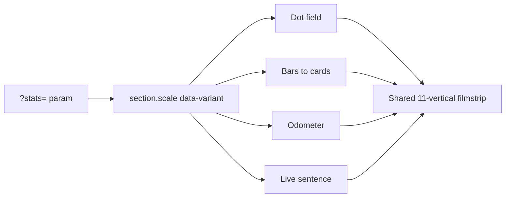

# Stats that lead into the verticals (exploration 02)

All four concepts get built in [03_Design/explorations/02-video-hero/index.html](03_Design/explorations/02-video-hero/index.html), replacing the current `#investors` section (the Square-style counters). They share one stats data set and one verticals filmstrip, so they're compared fairly. Only the active concept runs its script.

## How you switch between them
- Add `?stats=dots`, `?stats=bars`, `?stats=odometer` or `?stats=sentence` to the URL. With no parameter it shows dots.
- A small internal chip in the bottom-left corner switches concepts and rewrites the parameter. It's for the sandbox only and is marked internal.
- Markup: `<section class="scale" id="investors" data-variant="dots">` holds four `.scale-v--*` blocks. CSS shows only the matching one.

## Shared pieces
- **Stats** (one JS array): 70,000+ business customers, $75B processed on Fullsteam Pay, 480M+ transactions, 2,000+ people, and 11 verticals. Every figure except 11 is a placeholder. The screen-reader text says so, and payment volume is described as volume, never revenue (KB §20).
- **Verticals** (one JS array): the 11 names and slugs already used in the menu. Each card links to `../../../02_Wireframes/active/pages/vertical-software.html#slug`.
- **Filmstrip** `.vstrip`: 11 placeholder image cards in a horizontal row with a name on each. It reads as the destination for every concept. It's also the static fallback.
- **Motion rules** (same as the hero): progress is computed from each pin's own `getBoundingClientRect`, writes happen per frame through `requestAnimationFrame`, and those writes have no CSS transitions.
- **Reduced motion and no-JS**: no pin and no counting. The stats show as a plain row with final values, followed by the filmstrip.

## The four concepts

### 1. Dot field (default)
Pinned at about 320vh, drawn on one `<canvas>` (not thousands of DOM nodes).
- 0 to 0.30: it starts as a single dot labelled "1 business". Scrolling zooms out until about 3,500 dots fill the frame, while the counter ticks from 1 to 70,000+. A footnote says each dot stands for 20 businesses.
- 0.30 to 0.55: short light pulses travel between dots, and the 480M+ transactions counter runs.
- 0.55 to 0.85: the dots ease into 11 clusters, with each vertical name fading in under its cluster.
- 0.85 to 1: each cluster's box turns into its filmstrip card, and the pin releases straight into `.vstrip`.
- The canvas is `aria-hidden`; a visually hidden list carries the same stats.

### 2. Bars become cards
Pinned at about 260vh.
- The stats count up in a Square-style row at the top.
- Eleven thin bars rise from a baseline in a stagger. They all stop at equal height, so they don't suggest a revenue ranking.
- Each bar then widens into its vertical card through an interpolated `clip-path`, the same technique as the hero grow. The row becomes the filmstrip.

### 3. Odometer
Pinned at about 400vh.
- One huge number made of rolling digit columns (`tabular-nums` strips moved with `translateY`).
- Scrolling scrubs it through 70,000+, $75B, 480M+ and 2,000+, then lands on 11. The label under it swaps at each stop.
- At 11, the label becomes a rolling column of the vertical names. The pin then releases into the filmstrip, ordered the same way.

### 4. Live sentence
No pin; it uses the existing word readout (`.wwd-w` focus band) so it feels related to What we do.
- One large sentence along the lines of "We serve [70,000+] businesses across [11] industries, from [Hospitality] to [Wine] to [ERP], and move [$75B] through Fullsteam Pay." Final wording goes to the content team.
- Each number counts up as its line reaches the focus band.
- The vertical names are inline chips. When a chip reaches the center, or on hover or focus, it expands into a small card preview. The sentence then flows into the filmstrip.

## Files
- [index.html](03_Design/explorations/02-video-hero/index.html): replace the `#investors` markup, CSS, and the count-up script with the `.scale` system: shared data, the switcher, four scoped `init*` functions, and `.vstrip`.
- [direction.md](03_Design/explorations/02-video-hero/direction.md): add a changelog entry covering the four concepts, the switcher, and the placeholder and no-revenue rules.
- No edits to `design.md`, the wireframes, or the KB. This is sandbox work, and a verticals section after investors would be a homepage-order change that needs logging before promotion.

## Verification
Use Playwright screenshots of each concept at 1440x900 and 390x844 at several scroll points, plus one reduced-motion pass. Check four things: the number is always readable, the handoff into the filmstrip has no dead frame, the canvas holds frame rate (the dots render from a cached position buffer), and the filmstrip links resolve.