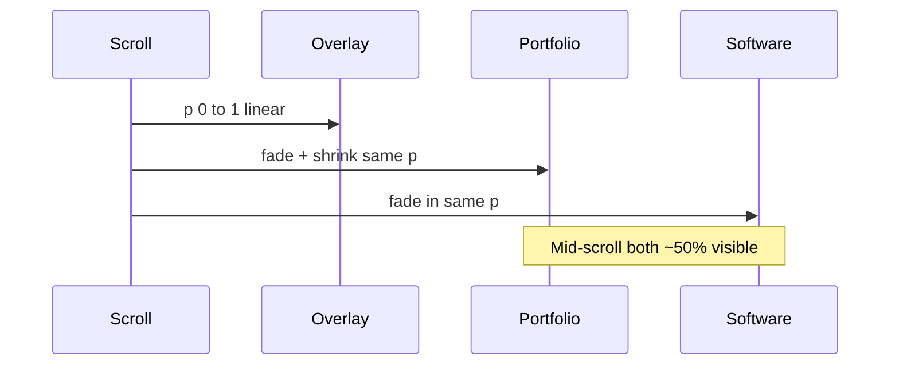
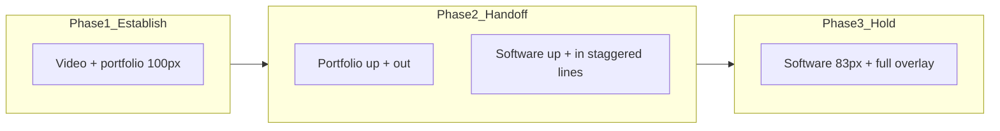

# Better headline transition (Exploration 02)

## What feels weak today

In [`03_Design/explorations/02-video-hero/index.html`](03_Design/explorations/02-video-hero/index.html), one scalar `--p` drives **everything at once**:

- base tint (`80% → 20%`)
- Desktop-2 gradient overlay (`0 → 1`)
- portfolio opacity (`1 → 0`) **and** font shrink (`100px → 83px`)
- software opacity (`0 → 1`)

**Why it reads poorly**

1. **Muddy middle** — linear crossfade keeps both headlines legible; investors read a blended story instead of portfolio → software.
2. **Competing motion** — shrinking portfolio while software appears at a different size/layout (one block vs two lines) causes a subtle “swap” rather than a directed beat.
3. **Overlay steals attention** — gradient and copy change start together, so the type handoff has no clear moment.

This is fine for a wireframe; it is not “premium cinematic” (the exploration’s goal per [`direction.md`](03_Design/explorations/02-video-hero/direction.md)).

---

## Recommended movement: phased vertical handoff

**Idea:** Treat scroll like a three-act cue inside the pin—**atmosphere first, then headline**, then **hold**.

| Phase | Scroll progress (of pin `t`, after `/0.7` settle) | Overlay / tint | Portfolio headline | Software headline |
|-------|--------------------------------------------------|----------------|--------------------|-------------------|
| **1 · Establish** | `0 → 0.28` | Tint eases; gradient **begins** late (starts ~0.15) | **Locked** at 100px, full opacity, `translateY(0)` | Hidden |
| **2 · Handoff** | `0.28 → 0.62` | Gradient continues | Fade out + **`translateY(-1.25em)`** (no shrink until exit) | Fade in + **`translateY(1.25em → 0)`**, line 2 lags by ~0.12 `t` |
| **3 · Hold** | `0.62 → 1` | Full Desktop-2 look | Gone | Fixed 83px, full opacity |

**Motion principles**

- **One dominant line at a time** — use **staggered opacity ramps** (portfolio `1→0` over a narrow window; software `0→1` starts ~0.12 `t` later), not `opacity: 1-p` and `opacity: p`.
- **Vertical direction** — outgoing moves **up** (previous thought leaves); incoming rises **into place** (next thought arrives). Matches editorial / title-sequence grammar without copying the locked **grow morph** (clip-path tile), which belongs to the wireframe opening (KB §23), not this sandbox.
- **Drop portfolio font shrink during crossfade** — either hold 100px until portfolio opacity hits ~0, **or** shrink only in the last 20% of portfolio exit. Avoid shrinking while software is visible.
- **Optional micro-depth** — during phase 2 only, `transform: scale(1.03)` on `.hero__media` (video) via a separate `--pVideo`; keeps movement in the frame when type is changing. Keep subtle; respect `prefers-reduced-motion`.

**Easing:** Map raw scroll `t` through a smoothstep (or piecewise linear segments) in JS when writing CSS vars—still **per-frame writes, no CSS `transition` on `--p`** (same discipline as the locked morph).

---

## Alternatives (if handoff feels too much)

| Option | When to use | Tradeoff |
|--------|-------------|----------|
| **Hard cut at 50% pin** | Maximum clarity, minimal motion | Less “cinematic”; can feel abrupt on video |
| **Blur-out / sharp-in** | Heavy film look | GPU cost; can feel trendy/SaaS |
| **Single headline morph** (shared words) | Only if copy shares a stable anchor | These two lines don’t share a clean morph path; risks merged claim |

**Avoid for 02:** horizontal slide (reads mobile carousel), rotation, or long crossfade (>40% overlap).

---

## Implementation sketch (02 only)

**Files:** [`03_Design/explorations/02-video-hero/index.html`](03_Design/explorations/02-video-hero/index.html) (CSS + scroll script); optional note in [`direction.md`](03_Design/explorations/02-video-hero/direction.md).

1. **Split `--p` into derived vars in `render()`** (set on `#hero`):
   - `--pOverlay`, `--pPortfolioOut`, `--pSoftwareIn`, `--pLine2` (0–1 each)
   - Use segment functions, e.g. `segment(t, start, end)` with clamp.

2. **CSS updates** (`.hero__title--portfolio`, `.hero__title--software`):
   - Replace `opacity: calc(1 - var(--p))` with `opacity: var(--pPortfolioOut)` inverted appropriately.
   - Add `transform: translateY(...)` from `--pPortfolioOut` / `--pSoftwareIn`.
   - Stagger `.hero__title--software .line:nth-child(2)` with `--pLine2`.
   - Remove or gate `font-size` shrink on portfolio until exit window.

3. **Decouple overlay/tint** from headline ramps (start gradient slightly before software, not with it).

4. **A11y:** Keep toggling `aria-hidden` when **software weighted opacity > 0.55** (or when `t > 0.5`), not a fixed 0.45.

5. **Reduced motion:** Unchanged policy—Desktop-1 only, no pin-linked vars.

6. **QA viewports:** 1440, 1024, 390; scrub pin slowly and confirm **no band where both headlines are equally dominant**; confirm CTAs don’t jump (headlines container `min-height` may need bump for two-line software block).

---

## Success criteria (internal review)

- At **~40%** through the pin, a viewer can still paraphrase **only** the portfolio line; at **~80%**, **only** the software line.
- Motion feels **intentional** (up/out → up/in), not a dissolve.
- Video continues uninterrupted; overlay change still matches Figma Desktop-2 intent.
- No change to locked homepage opening (wireframe grow morph)—this stays sandbox-only.
