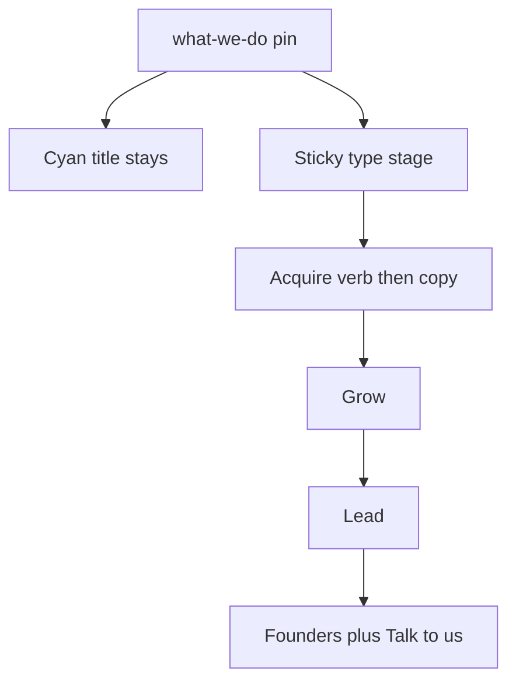

# What we do: hero-matched scroll text

Scope is only the **What we do** band in [03_Design/explorations/02-video-hero/index.html](03_Design/explorations/02-video-hero/index.html). Do not change the hero ramps, cube collapse, or header. Log in [direction.md](03_Design/explorations/02-video-hero/direction.md). Stay in the gitignored sandbox.

## Why pin, not stack-and-reveal

The hero’s scroll text is a **replacement in one slot**: lines exit up as the next lines enter from below, with overlap so a headline is always readable. The Figma frame stacks Acquire / Grow / Lead / Founders as a long column. To reuse that motion language (and the “something is always readable” rule), the four beats should occupy **one sticky type stage** under the cyan title, not four in-flow blocks that all sit on screen.

Reduced-motion / no-JS fallback restores the stacked Figma layout.

## Motion language (copy from the hero)

Reuse the existing formulas — no CSS transitions on per-frame writes:

- **Exit (current beat):** `opacity: 1 − --line-exit`; `translateY(-1.25em × exit)`; `blur(0.04em × exit)`
- **Enter (next beat):** `opacity: --line-op`; `translateY(1.25em × (1 − op))`; `blur(0.04em × (1 − op))`
- **Gold verb** behaves like the hero’s gold `em`: `scale(0.9 + 0.1 × op)` on enter, reverse on exit
- **Copy line(s)** stagger after the verb (~0.06–0.08 of local progress), same as hero line 2/3
- **Talk to us** fades/rises with Founders’ last line; `pointer-events` only when that beat is open
- Shrink, if used at all, is `transform: scale` — never `font-size`

Reuse `clamp01`, `segment`, `smoothstep`, and rAF from the hero script in a **sibling IIFE** on `#what-we-do` so the hero `render()` stays untouched.

## Pin and ramps

- Sticky inner frame ≈ `100svh − --bar-h`. Pin height ≈ **320–360vh** so four overlapping handoffs plus a short hold fit without a dead tail.
- Progress `p` from the section’s `getBoundingClientRect` vs `offsetHeight − innerHeight` (same mapping as the hero pin).
- Suggested windows (tune so overlap keeps ≥ ~60% of one beat visible):
  - Title in: `0.00–0.10` (then holds)
  - Acquire in: `0.06–0.22`
  - Acquire out / Grow in: `0.24–0.42`
  - Grow out / Lead in: `0.44–0.62`
  - Lead out / Founders in: `0.64–0.82`
  - Founders hold + CTA: `0.82–1.00`
- Header already goes `.is-solid` when `.hero-stage` leaves the viewport — keep that; this section sits on `--blue` so a solid bar is correct.

## Markup / CSS

- Keep the four `.what-we-do__step` nodes (a11y order Acquire → Grow → Lead → Founders).
- Wrap them in `.what-we-do__stage` with a **fixed min-height** of the tallest beat (Founders = verb + copy + 44px pill) so the CTA never reflows the layout.
- Overlay steps (`position: absolute; inset: 0`) while pinned; in `.is-flow` / `html:not(.has-js)` they stack with the current `gap: 100px` (Figma).
- Split copy that already uses ` ` into `.line` spans if needed so Lead/Founders can stagger line 2.

## Fallbacks

- `prefers-reduced-motion` and no JS: no pin, all four beats visible, opacity 1, no blur. Title and CTA visible.
- Do not `aria-hidden` the unused beats during the pin (same rule as the hero headlines).

## Verify

- 1440×900 and 390×844: no empty mid-handoff, no CTA jump, Founders readable with the pill.
- Reduced-motion: full stacked section.
- Hero sequence unchanged (spot-check handoff + cube).
