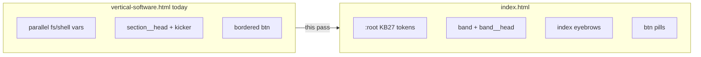

# Vertical Software page — homepage design parity

> **Status:** client-review build · in progress (2026-11-03).
> **Scope:** align [`03_Design/client-review/homepage/vertical-software.html`](../03_Design/client-review/homepage/vertical-software.html)
> with the official homepage ledger system in the same folder; **keep the dark-gradient hero** and
> sidebar/panel IA — no Axis A/B opening, no new sections (close band / scroll reveal / ink FAQ).
> **Also:** short changelog note in [`design-notes.md`](../03_Design/client-review/homepage/design-notes.md).

## Goal

Make `vertical-software.html` read as the same **editorial ledger** system as [`index.html`](../03_Design/client-review/homepage/index.html), per client choices: **keep the gradient hero**, **no close band / scroll reveal / ink FAQ**.

**In scope:** one file ([`vertical-software.html`](../03_Design/client-review/homepage/vertical-software.html)) + a short note in [`design-notes.md`](../03_Design/client-review/homepage/design-notes.md).

**Out of scope:** sitemap/IA, panel content, wireframes, shared CSS extraction, homepage edits.

## Why it feels different today

Both pages claim “same chrome/tokens” (design-notes 2026-11-03), but the verticals file still runs a **parallel token namespace** and component specs:

| Area | Homepage (`index.html`) | Verticals (`vertical-software.html`) |
|------|-------------------------|-------------------------------------|
| Max width | `--wrap: 1280px`, wider `--gutter` | `--shell: 1072px` |
| Section rhythm | `--sect: clamp(84px, 10vw, 148px)` via `.band` | `--section-y: clamp(72px, …)` |
| Body / ink | `--ink: #0C1B21` on body | `--text: #0c1b21` + separate `--ink: #04141b` (hero bg) |
| Type scale | `--t-hero`, `--t-h2`, `--t-stat`, `--label` | `--fs-hero`, `--fs-section`, `--fs-stat`, ad hoc sizes |
| Section eyebrows | `.index` (40px gold rule, 12px mono) | `.kicker` (26px rule) |
| Section heads | `.band__head` 12-column grid (H2 cols 1–8, lede 9–12) | `.section__head` 2-column ratio grid |
| Buttons | Borderless gold pill; hover via `color-mix` | Bordered `.btn` with black hover |
| Stats | `.stat__n` at `--t-stat`, weight 500 | `.stat__val` at `--fs-stat`, weight 700 |
| Minor | `::selection`, `--focus` on bar, `.skip-link` | `.skip`, no selection styling; `btn--gold` in markup but **no CSS** |

Chrome (bar, menu, progress, footer) is already largely ported; the gap is **ledger typography + spacing + components** below the header.



## Implementation plan

### 1. Replace `:root` and base document styles

Copy the homepage token block from [`index.html`](../03_Design/client-review/homepage/index.html) lines ~81–122 (palette, `--wrap`, `--gutter`, `--sect`, `--t-*`, `--sans`/`--serif`/`--mono`, easings).

- Map legacy names with aliases only where it reduces diff noise, e.g. keep `--brand-ink` for the hero background.
- Point body `color` / `font-family` / `font-size` at homepage equivalents (`--ink`, `--sans`, `--t-body`, `line-height: 1.55`).
- Add homepage base polish: `::selection`, `scrollbar-gutter: stable` on `html`, `.sr-only`, `:focus-visible` using `--focus`.

### 2. Unify layout wrapper

- Rename `.shell` → `.wrap` in markup and CSS (or make `.shell { width: min(var(--wrap), …) }` — prefer **`.wrap`** for parity with homepage).
- Update all section vertical padding to `var(--sect)` (`.verticals`, `.faq`, hero padding can stay hero-specific but use the same gutter math).

### 3. Typography components (markup + CSS)

**Eyebrows:** Replace `.kicker` with homepage `.index` in the hero, verticals band intro, and FAQ head. Example pattern from homepage model/verts bands:

```html
<p class="index"><b>Vertical software</b></p>
```

(Use `<b>` for the emphasized label where homepage uses chapter indexes.)

**Display scale:**

- Hero H1: add `display display--xxl` (or equivalent rules using `--t-hero`).
- Section H2s (`#verticals-title`, `#faq-title`): `display display--l` + keep gold `em` rule (mirror `#vertsTitle em` on homepage).
- Panel H3s: `display display--m` where sizes should match interior headings.

**Lede:** Use homepage `.lede` max-width (`54ch`, `text-wrap: pretty`) and dark-band override on `.hero .lede`.

**Delete or shrink** redundant custom classes (`--fs-hero`, `--fs-section`, etc.) once mapped to `--t-*`.

### 4. Section heads → homepage grid

Refactor `.section__head` CSS to match [`.band__head`](../03_Design/client-review/homepage/index.html) (12-col grid, `align-items: end`, same breakpoints at ~1024/600 as homepage). Keep the **same HTML regions** (title block + aside lede); only layout rules change.

Optional within “keep gradient hero”: apply the same **12-col split** to `.hero__row` (title left, lede/CTA right) so the hero matches homepage band rhythm without adding photography. Today `.hero__row` has no desktop grid (only collapses at 1080px) — this is a small structural fix inside the existing hero.

### 5. Buttons and chrome details

- Replace verticals `.btn` block with homepage rules (no default border; `color-mix` hover).
- Markup: `btn btn--gold` → `btn` / `btn btn--sm` on bar CTA (match [`index.html`](../03_Design/client-review/homepage/index.html) header).
- Align `.bar` focus token (`--focus: #fff` default, flip on `.is-solid`) like homepage.

### 6. Stats row (panel)

Restyle `.stat__val` / `.stat__label` to match homepage [`.stat__n` / `.stat__c`](../03_Design/client-review/homepage/index.html) (`--t-stat`, weight 500, `stat__c` caption sizing). **Keep class names in HTML** if easier — CSS-only mapping is fine.

Keep the existing **3-column ink top border** on `.stats` (already ledger-like); only type weight/size should change.

### 7. Frames and mono labels (light touch)

- Align `.frame` border/radius with homepage photography treatment where index uses editorial frames (check careers/founders — likely tighter or no radius); avoid changing carousel behavior for Weddings panel.
- Align `.frame__cap` / rail labels to `--label` and `--mono` sizing from homepage.

### 8. Footer + skip link

- Match homepage footer font-size (`var(--t-small)`), `h3` margin, and `--focus` on footer.
- Rename `.skip` → `.skip-link` + same fixed pill behavior as homepage (cosmetic parity).

### 9. QA checklist (manual)

- **1440 / 390 / 320:** hero title scale, section heads, sidebar sticky + mobile rail pills unchanged functionally.
- **Header states:** dark hero → `is-on-dark`; scrolling into `#verticals` → `is-solid`; no content bleeding through logo (same `data-surface` + scroll JS already present).
- **Weddings carousel:** unchanged interaction after frame CSS tweaks.
- **Hash deep links** (`#weddings-events`, etc.): panel swap still works.
- Side-by-side browser compare with `index.html` model + verticals bands for type rhythm.

### 10. Document

Add a subsection under **2026-11-03** in [`design-notes.md`](../03_Design/client-review/homepage/design-notes.md): tokens/components aligned to 2026-11-02 homepage ledger; hero structure unchanged; no new sections.

## Files touched

- [`03_Design/client-review/homepage/vertical-software.html`](../03_Design/client-review/homepage/vertical-software.html) — primary work
- [`03_Design/client-review/homepage/design-notes.md`](../03_Design/client-review/homepage/design-notes.md) — changelog only

## Risk notes

- **Token rename churn:** Prefer updating CSS variables in place over renaming every `var(--text)` if diff size explodes; end state should **look** like homepage, not necessarily identical variable names everywhere.
- **Panel markup is huge:** Limit HTML edits to shared patterns (classes on heroes/sections), not per-panel rewrites.
- **Publishability unchanged:** Weddings stats/copy stay as-is (KB §29.7 / OI-16).

## Implementation todos

1. Port homepage `:root` + base/typography primitives; unify `.wrap` and `--sect`.
2. Replace kicker with `.index`; refactor `section__head` (+ optional `hero__row`) to `band__head` grid; apply `display--*` classes.
3. Match homepage `.btn`, stat typography, bar focus, skip-link, footer micro-diffs.
4. Light frame label alignment; manual QA at key widths; update `design-notes.md`.
